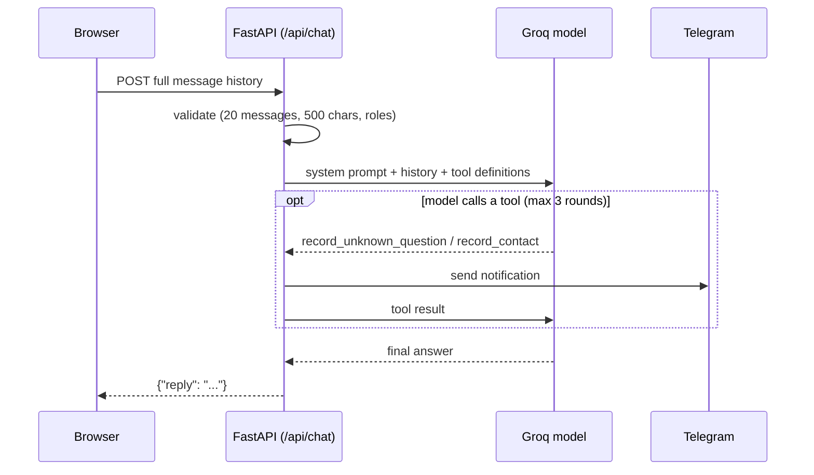

# Digital Twin

A chat website that lets recruiters and hiring managers talk to a digital twin of Eren Kara instead of reading a CV. The twin answers questions about his career using only the Markdown files in `data/`. When it does not know the answer it admits it and notifies Eren on Telegram instead of making something up. Visitors who want to get in touch can leave their name and email, which are also forwarded to Telegram.

**Live demo:** https://digital-twin-dc3h.vercel.app

## Features

- **Grounded answers.** The whole knowledge base (a few thousand words) is placed in the system prompt. There is no vector database, embeddings or RAG at this size.
- **No guessing.** Questions outside the knowledge base trigger the `record_unknown_question` tool, which sends a Telegram notification to the owner.
- **Contact capture.** The `record_contact` tool forwards a visitor's name, email and note to Telegram. Nothing is stored server-side.
- **Model fallback.** On a rate limit (429) the same request is retried once with a backup model, then the visitor sees a friendly "try again shortly" message.
- **Stateless backend.** The browser keeps the conversation and sends the full history with every request.
- **Abuse limits.** At most 20 messages per request, 500 characters per visitor message, no client-supplied `system` role, and model output is rendered as plain text (never as HTML).
- **Evaluation harness.** 15 questions (10 answerable, 5 not) check for correct answers and for the absence of fabrication.

## How it works



## Tech stack

| Part | Choice |
|---|---|
| Backend | Python 3.12, FastAPI, Pydantic |
| Models | `openai/gpt-oss-120b` on Groq, fallback `llama-3.3-70b-versatile`; local `llama3.2` on Ollama for development |
| Client | `openai` SDK pointed at an OpenAI-compatible endpoint |
| Frontend | A single static `public/index.html` (plain HTML and JavaScript) |
| Notifications | Telegram Bot API |
| Hosting | Vercel (Python function plus static files) |
| Tests | pytest |

## Project structure

```
.
├── main.py              FastAPI app, POST /api/chat, request validation
├── twin/
│   ├── prompt.py        Builds the system prompt from data/*.md
│   ├── chat.py          Model call, tool loop, fallback model, terminal chat
│   └── tools.py         Tool definitions, argument validation, Telegram sender
├── data/
│   ├── profile.md       Summary, experience, education, skills
│   ├── projects.md      Projects with stack, role and outcome
│   └── faq.md           Answers to common recruiter questions
├── public/index.html    Chat interface
├── eval/
│   ├── questions.jsonl  15 evaluation questions
│   └── run.py           Asks them and checks the answers
├── tests/               pytest suite
├── vercel.json          Bundles data/ into the serverless function
├── requirements.txt
└── .env.example
```

## Getting started

### Prerequisites

- Python 3.12+ and [uv](https://docs.astral.sh/uv/)
- A [Groq](https://console.groq.com) API key
- A Telegram bot token (create one with `@BotFather`) and your chat id
- Optional: [Ollama](https://ollama.com) with `llama3.2` for local development without spending API quota
- Optional: the [Vercel CLI](https://vercel.com/docs/cli) to run the full site locally

### Install

```bash
uv venv
uv pip install -r requirements.txt
cp .env.example .env
```

### Configure

Fill in `.env`:

| Variable | Description |
|---|---|
| `GROQ_API_KEY` | Groq API key (starts with `gsk_`) |
| `TELEGRAM_BOT_TOKEN` | Token from `@BotFather` |
| `TELEGRAM_CHAT_ID` | Your chat id. Message your bot once, then open `https://api.telegram.org/bot<TOKEN>/getUpdates` and read `chat.id` |
| `CHAT_PROVIDER` | Optional. `groq` (default) or `ollama` |

Never commit `.env`. It is listed in `.gitignore`.

### Write your own data

Replace the three files in `data/` with your own content. They are read at startup and concatenated into the system prompt, so anything in them can be repeated to visitors. Do not include a phone number, home address, ID numbers, salary history or client names you are not allowed to share.

## Usage

Chat in the terminal (the quickest way to try prompt changes):

```bash
.venv/bin/python -m twin.chat ollama   # local model
.venv/bin/python -m twin.chat groq     # Groq
```

Run the whole site locally (API and page):

```bash
vercel dev
```

Run the evaluation. It records tool calls instead of sending real Telegram messages:

```bash
.venv/bin/python -m eval.run groq
```

Run the tests:

```bash
.venv/bin/pytest
```

## API

`POST /api/chat`

```json
{ "messages": [ { "role": "user", "content": "Where does Eren live?" } ] }
```

| Rule | Limit |
|---|---|
| Messages per request | 1 to 20 |
| Visitor message length | 500 characters |
| Assistant message length (echoed history) | 4000 characters |
| Roles | `user` or `assistant`; the last message must be from the user |

Responses: `200 {"reply": "..."}`, `400 {"error": "Invalid request."}` for anything that fails validation (the rejected input is never echoed back), `502 {"error": "..."}` when the model or an upstream call fails.

## Deployment (Vercel)

1. Push the repository to GitHub.
2. In Vercel choose **Add New > Project** and import the repository. Vercel detects the FastAPI app in `main.py` and serves `public/` as static files.
3. Under **Settings > Environment Variables** add `GROQ_API_KEY`, `TELEGRAM_BOT_TOKEN` and `TELEGRAM_CHAT_ID`, then redeploy.
4. Under **Settings > Deployment Protection** turn off Vercel Authentication, otherwise visitors are redirected to a Vercel login.
5. Ask a few questions on the live site to confirm `data/` is readable. `vercel.json` includes `data/**` in the function bundle for this reason.

## Known limitations

- There is no per-IP rate limit because that would need a database. Protection is the per-request message and length limits. If the daily Groq quota runs out, the site shows a friendly error until it resets.
- Contact details are not persisted anywhere. They only reach the owner as a Telegram message.
- Evaluation checks use keyword matching and tool calls, so they cannot prove that an answer contains no fabrication. Review the printed answers as well.

## License

No license has been chosen yet. Add one before accepting contributions.
